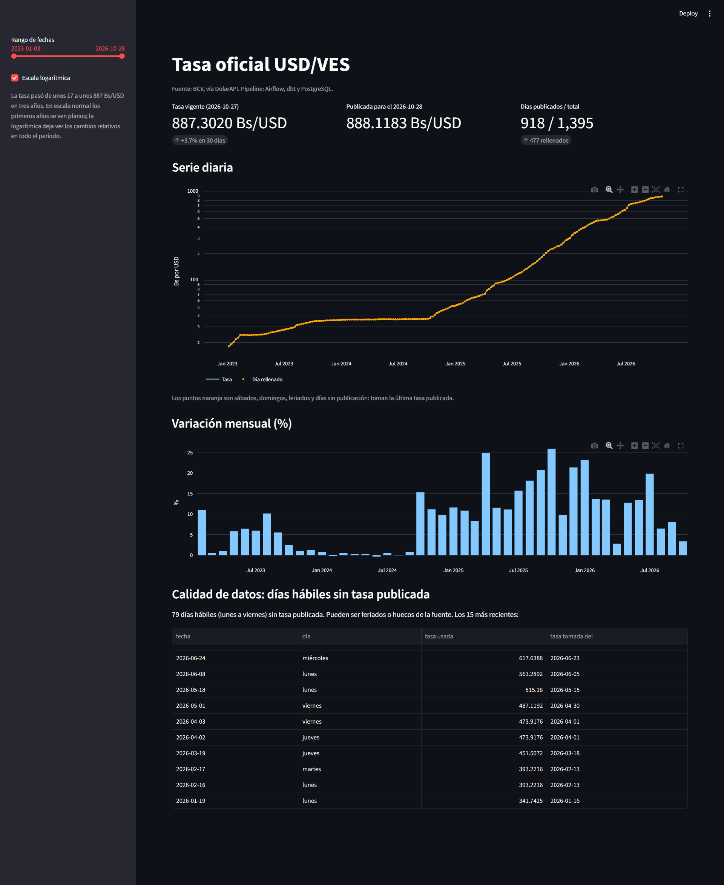
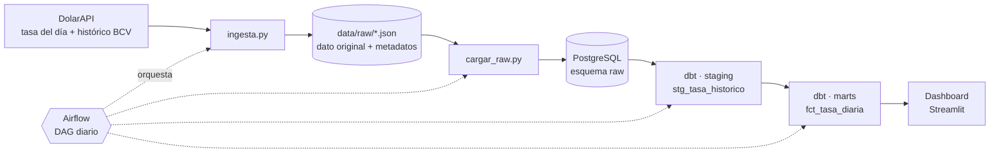

<h1 align="center">Pipeline de tasas de cambio USD/VES</h1>

<p align="center">
  Pipeline de datos de punta a punta: ingesta, capa cruda, modelado con dbt,
  orquestación con Airflow y dashboard, todo con Docker.
</p>

<p align="center">
  
  
  
  
  
  
</p>

<p align="center">
  
</p>
> Proyecto de portafolio de ingeniería de datos. No está afiliado al Banco Central de Venezuela.

## El problema

La tasa oficial solo se publica en días hábiles, y a veces con huecos. Un analista que necesite convertir precios de cualquier día (un sábado, un feriado) o graficar una serie continua no puede usar la fuente tal como llega. Este pipeline entrega una tabla lista para consultar: un registro por cada día del calendario, con una marca que dice si la tasa fue publicada ese día o rellenada.

## Arquitectura



| Capa | Qué contiene |
| --- | --- |
| Archivos crudos | Respuesta original de la API en JSON, con la fecha de descarga y la URL de origen |
| `raw` | Los mismos JSON en tablas de PostgreSQL (`raw.tasa_oficial`, `raw.tasa_historico`), sin transformar |
| `staging` | Una fila por fecha, tipada, tomando la descarga más reciente |
| `marts` | Calendario completo (`marts.fct_tasa_diaria`) con la regla de relleno y la marca `es_dia_publicado` |

## Qué demuestra este proyecto

- Ingesta desde una API pública, con guardado inmutable del dato original.
- Carga idempotente a PostgreSQL, con transacción única entre fuentes.
- Modelado por capas (raw, staging, marts) con dbt y funciones de ventana en SQL.
- Pruebas de calidad de datos, entre ellas detección de fuente desactualizada.
- Orquestación con Airflow, con reintentos y ejecución diaria programada.
- Reproducibilidad: un clon del repositorio levanta todo con `docker compose up`.

## Stack

Python, PostgreSQL 17, dbt Core 1.12 (adaptador postgres 1.11), Apache Airflow 3.3 con LocalExecutor, Docker Compose, Streamlit, Plotly.

<details>
<summary><b>Decisiones de diseño</b></summary>

- **Capa cruda inmutable.** ...
- **Carga idempotente.** ...

</details>

## Decisiones de diseño

- **Capa cruda inmutable.** La respuesta de la API se guarda tal cual, dentro de un "sobre" con `descargado_en` y `url_fuente`. Si cambian las reglas de transformación, siempre se puede rehacer todo desde el original.
- **Carga idempotente.** Cada archivo se identifica por su nombre (`UNIQUE`) y el `INSERT` usa `ON CONFLICT DO NOTHING`. Ejecutar el pipeline dos veces no duplica datos, y el cargador informa cuántos archivos cargó y cuántos omitió.
- **Una transacción para todas las fuentes.** Si falla la carga de una fuente, se deshace todo y no queda nada a medias.
- **Deduplicación con función de ventana.** Cada descarga del histórico trae todas las fechas otra vez. En `staging`, `ROW_NUMBER() OVER (PARTITION BY fecha ORDER BY descargado_en DESC)` deja una sola fila por fecha: la de la descarga más reciente.
- **Relleno hacia adelante, sin esconderlo.** Los fines de semana y feriados toman la última tasa publicada, pero cada fila lleva `es_dia_publicado` para distinguirlos. Quien consume la tabla decide qué hacer con los días rellenados.
- **Airflow ligero.** Un solo contenedor con LocalExecutor y la base de metadatos en el mismo PostgreSQL, porque el equipo de desarrollo tiene unos 3.5 GiB de memoria para Docker.
- **dbt en un entorno virtual aparte** dentro de la imagen de Airflow, para que sus dependencias no choquen con las de Airflow.

## Calidad de datos

Se ejecutan 10 pruebas con `dbt test` en cada corrida:

- `unique` y `not_null` sobre la fecha, la tasa y la marca de publicación.
- `tasa_positiva`: falla si hay una tasa menor o igual a cero.
- `datos_recientes`: falla si el dato más reciente tiene más de 4 días de atraso (detecta una fuente caída o un pipeline detenido).
- `salto_diario_extremo`: avisa si la tasa cambia más de 20% entre dos días publicados.

## Qué se encontró en los datos

Hallazgos de la corrida del 27 de octubre de 2026:

- El histórico de la fuente empieza el 2023-01-03 y trae solo días hábiles (ningún sábado ni domingo).
- De 1395 días del calendario, 918 tienen tasa publicada y 477 fueron rellenados. Unos 400 son fines de semana, así que el resto son feriados o días hábiles sin dato.
- La fuente no publicó el lunes 2026-10-26; el modelo lo marca como día rellenado.
- La fuente trae tasas con fecha posterior a la de descarga (el 2026-10-28 ya estaba disponible el 27). Lo más probable es que la fecha sea la de entrada en vigor, y que el BCV publique con un día hábil de anticipación, pero no está confirmado.
- Ninguna variación diaria superó el 20%.

## Cómo ejecutarlo

Requisitos: Docker con Docker Compose.

```powershell
git clone <url-del-repositorio>
cd pipeline-tasas-ve
copy .env.example .env      # y cambia la contraseña
docker compose up -d --build
```

La primera vez, la construcción de la imagen de Airflow tarda varios minutos. Las tablas de `raw` y la base de metadatos de Airflow se crean solas al iniciar PostgreSQL por primera vez (carpeta `sql/`).

1. Saca la contraseña de Airflow de los logs: `docker compose logs airflow | Select-String -Pattern "password"`
2. Abre `http://localhost:8081` con el usuario `admin`.
3. Activa el DAG `pipeline_tasas_ve` y lánzalo con el botón de ejecutar. Corre solo todos los días a las 22:00, hora de Caracas.
4. Cuando el DAG termine, abre el dashboard en `http://localhost:8501`. Si lo abres antes de la primera ejecución, avisa que aún no hay datos.

Para consultar el resultado:

```powershell
docker compose exec postgres psql -U tasas -d tasas_ve -c "SELECT * FROM marts.fct_tasa_diaria ORDER BY fecha DESC LIMIT 10;"
```

## Estructura del proyecto

```
├── ingesta.py              # descarga las dos fuentes y guarda el JSON crudo
├── cargar_raw.py           # carga los JSON nuevos a PostgreSQL (idempotente)
├── airflow/
│   ├── Dockerfile          # imagen de Airflow con dbt y dependencias
│   └── dags/pipeline_tasas.py
├── dbt_tasas/              # modelos, pruebas y configuración de dbt
├── sql/                    # creación del esquema raw y de la base de Airflow
├── dashboard/              # app de Streamlit que lee la tabla final
├── docs/dashboard.png      # captura del dashboard
├── docker-compose.yml
└── requirements.txt        # entorno local de desarrollo
```
> [!WARNING]
> La fuente es un servicio de terceros sin garantía de disponibilidad. El pipeline tolera fallos con reintentos y vigila la frescura del dato, pero no los evita.

## Limitaciones conocidas

- **La fuente es un servicio de terceros** (DolarAPI) sin garantía de disponibilidad. Una API anterior que se evaluó para obtener el histórico desde 2016 dejó de existir durante el desarrollo; por eso la ingesta usa reintentos y `datos_recientes` vigila la frescura.
- **`raw.tasa_oficial` se carga pero todavía no alimenta los modelos.** Hoy solo el histórico llega a `staging` y `marts`.
- **Autenticación de Airflow simplificada**: guarda la contraseña en texto plano y no es apta para producción.
- **La hora de ejecución (22:00) es una estimación** de cuándo ya está publicada la tasa del siguiente día hábil.

## Próximas mejoras

- Usar la tasa del día para detectar diferencias con el histórico.
- Alertas cuando falle una tarea.

## Autor

Johiner Almeida · [LinkedIn](www.linkedin.com/in/johiner-almeida) · [GitHub](https://github.com/Johiner17)